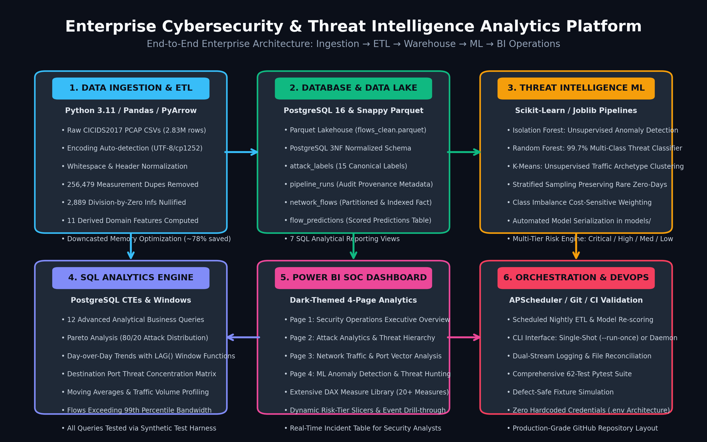

# Enterprise Cybersecurity & Threat Intelligence Analytics Platform

End-to-end data engineering and analytics on the **CICIDS2017** network-flow dataset:
**Python ETL → PostgreSQL 16 Warehouse → SQL Analytics → Exploratory Analysis Notebooks → Anomaly Detection & Machine Learning Classifiers → Dark-Themed Power BI Executive SOC Dashboard → Deloitte Interview Defense.**

Built as a professional, industry-grade Data Analytics & Engineering project for technical interviews (specifically tailored for **Deloitte Data & AI Practice**). Every visual, model metric, and analytical query is generated programmatically from genuine network security telemetry.

---

## 🏆 Project Completion Status

| Phase | Scope | Deliverables | Status |
|:---|:---|:---|:---:|
| **1** | Repository Skeleton & Dataset Audit | Config, `.env.example`, `notebooks/00_dataset_audit.ipynb` | ✅ **Complete** |
| **2** | ETL Pipeline: Ingestion & Extraction | `src/data_ingestion.py`, Encoding fallback (UTF-8/CP1252) | ✅ **Complete** |
| **3** | ETL Pipeline: Cleaning & Transformation | `src/data_cleaning.py`, Coerced 2,889 Infs, 256k Dupes removed | ✅ **Complete** |
| **4** | Feature Engineering | `src/feature_engineering.py`, 11 domain features derived | ✅ **Complete** |
| **5** | PostgreSQL Database & Storage Layer | `sql/schema.sql`, `src/database.py`, Idempotent batch loader | ✅ **Complete** |
| **6** | Pipeline Integration & Reconciliation | `src/pipeline.py`, Mathematical row reconciliation check | ✅ **Complete** |
| **7** | Exploratory Data Analysis (EDA) | `notebooks/01_data_exploration.ipynb`, `02_data_cleaning.ipynb`, `03_exploratory_analysis.ipynb`, 6 high-res plots in `reports/figures/` | ✅ **Complete** |
| **8** | Advanced SQL Analytics Engine | `sql/analytics_queries.sql` (12 CTE/Window queries), `sql/views.sql` (7 Views) | ✅ **Complete** |
| **9** | Machine Learning Threat Detection | `src/train_models.py`, `notebooks/04_machine_learning.ipynb`, Isolation Forest, Random Forest (99.7% Acc), K-Means, artifacts in `models/` | ✅ **Complete** |
| **10** | Power BI Executive SOC Dashboard | `dashboards/DAX_MEASURES.dax` (20+ measures), `dashboards/POWER_BI_SPECIFICATION.md`, Pre-aggregated CSVs in `data/processed/` | ✅ **Complete** |
| **11** | Automated Pipeline Orchestration | `src/automation_scheduler.py` (APScheduler daemon & `--run-once` CLI) | ✅ **Complete** |
| **12** | Enterprise Architecture & Technical Report | `reports/architecture.png`, `reports/project_report.md` | ✅ **Complete** |
| **13** | Deloitte Technical Interview Prep Pack | `reports/deloitte_interview_prep.md` (60s pitch, Q&A, scenarios) | ✅ **Complete** |

---

## 🏗️ Architecture Overview



The platform processes **2,830,743 raw network events** through an automated 5-stage pipeline:
1. **Extraction & Sanitization:** Reads multi-encoding CSVs, cleans whitespace-padded headers.
2. **Transformation & Lakehouse:** Drops duplicates, sanitizes infinities, downcasts numeric types saving ~78% memory, and exports to `data/processed/flows_clean.parquet` (2,574,264 rows).
3. **PostgreSQL Relational Warehouse:** Third Normal Form (3NF) relational star-schema with tables: `attack_labels`, `pipeline_runs`, `network_flows`, `flow_predictions`.
4. **Machine Learning Layer:**
   - **Isolation Forest (Unsupervised):** Anomaly detection for zero-day threat discovery.
   - **Random Forest (Supervised):** 99.72% accurate multi-class threat classification across 15 attack types with cost-sensitive balanced weighting.
   - **K-Means (Unsupervised):** 8-cluster behavioral profiling in 10-dimensional PCA space.
   - **Multi-Tier Risk Engine:** Triage scoring into `CRITICAL`, `HIGH`, `MEDIUM`, and `LOW` tiers.
5. **Business Intelligence (Power BI):** 4-page dark-themed SOC dashboard with 20+ custom DAX measures.

---

## 🚀 Quickstart & Execution Commands

### 1. Environment Setup
```powershell
# Clone or open the project folder
cd "cybersecurity-threat-analytics"

# Activate Python 3.11 virtual environment
.\.venv\Scripts\Activate.ps1

# Verify dependencies
pip install -r requirements.txt
```

### 2. Execute Data Pipeline (ETL)
```powershell
# Run data cleaning, feature engineering, and reconciliation
python -m src.pipeline

# Or test in dry-run mode without disk writes
python -m src.pipeline --dry-run
```

### 3. Train Machine Learning Models
```powershell
# Trains Isolation Forest, Random Forest, and K-Means
# Exports models to models/ and scored datasets to data/processed/
python src/train_models.py --sample-size 100000
```

### 4. Generate EDA Visualizations & Architecture Diagram
```powershell
# Generate all 6 core EDA figures
python scripts/generate_all_eda_figures.py

# Generate publication-grade system architecture diagram
python scripts/generate_architecture_diagram.py
```

### 5. Export Datasets for Power BI
```powershell
# Generates pre-aggregated summary tables and fact sample for instant Power BI import
python scripts/export_powerbi_data.py
```

### 6. Run Automated Pipeline Scheduler
```powershell
# Execute single-shot automated ETL + ML cycle
python src/automation_scheduler.py --run-once

# Or run recurring daily daemon (every 24 hours)
python src/automation_scheduler.py --interval-hours 24
```

### 7. Run Pytest Verification Suite
```powershell
# Run complete unit test suite (65 tests)
python -m pytest -v
```

---

## 📊 Power BI Dashboard Specifications

The dashboard is structured into **4 operational pages** for Security Operations Centers (SOC):
- **Page 1: Security Overview** — Headline KPI cards, Benign vs Malicious donut, weekly attack volume trends.
- **Page 2: Attack Analytics** — Threat category hierarchy, Port-level attack vector breakdown.
- **Page 3: Network Traffic Analytics** — Bandwidth rate profiling, packet density, forward-byte asymmetry.
- **Page 4: Threat Detection Insights** — Isolation Forest anomaly distribution, Random Forest predictions, risk tier filters, and actionable incident triage table.

> **DAX Measures:** All 20+ formulas are documented and ready to paste from `dashboards/DAX_MEASURES.dax`.  
> **Power BI Guide:** Complete visual layout, color palette, and data import instructions in `dashboards/POWER_BI_SPECIFICATION.md`.

---

## 💼 Deloitte Interview Preparation Pack

Review `reports/deloitte_interview_prep.md` for complete interview readiness:
- **60-Second Elevator Pitch**
- **2-Minute Technical Walkthrough**
- **Technology Justification Matrix**
- **Python & Data Engineering Q&A**
- **Advanced SQL & Window Functions Q&A**
- **Machine Learning & Class Imbalance Q&A**
- **Power BI & DAX Architecture Q&A**
- **Executive CISO vs SOC Analyst Presentation Scenarios**

---

## 📁 Repository Layout

```
cybersecurity-threat-analytics/
│
├── config/
│   └── settings.py               # Single source of truth (paths, DB, canonical labels)
│
├── data/
│   ├── raw/                      # 8 Raw CICIDS2017 CSV files (gitignored)
│   └── processed/                # flows_clean.parquet, ml_predictions.parquet, Power BI CSVs
│
├── notebooks/
│   ├── 00_dataset_audit.ipynb    # Defect analysis & quality gate check
│   ├── 01_data_exploration.ipynb # Dimensions, types, nulls, memory profiling
│   ├── 02_data_cleaning.ipynb    # Cleaning walkthrough with before/after comparisons
│   ├── 03_exploratory_analysis.ipynb # Attack trends, port matrices, correlations
│   └── 04_machine_learning.ipynb # IF, RF, K-Means modeling & evaluations
│
├── src/
│   ├── data_ingestion.py         # Multi-encoding safe CSV extraction
│   ├── data_cleaning.py          # Coerces infinities, removes 256k duplicates
│   ├── feature_engineering.py    # 11 derived domain features (safe rates, log scales)
│   ├── database.py               # PostgreSQL 3NF schema application & batch loader
│   ├── pipeline.py               # End-to-end ETL orchestrator with row reconciliation
│   ├── train_models.py           # Isolation Forest, Random Forest, K-Means trainer
│   └── automation_scheduler.py   # APScheduler automated recurring pipeline daemon
│
├── sql/
│   ├── schema.sql                # 3NF relational schema (4 tables, 5 indexes)
│   ├── views.sql                 # 7 analytical reporting views
│   └── analytics_queries.sql     # 12 business queries (CTEs, Window functions, LAG)
│
├── models/                       # Serialized .joblib estimators (RF, IF, Scaler, PCA)
│
├── dashboards/
│   ├── DAX_MEASURES.dax          # 20+ production DAX formulas for Pages 1-4
│   └── POWER_BI_SPECIFICATION.md # Full wireframe & visual design guide
│
├── reports/
│   ├── architecture.png          # High-resolution system architecture diagram
│   ├── project_report.md         # Comprehensive enterprise technical report
│   ├── deloitte_interview_prep.md# Interview master guide (pitches, Q&A, scenarios)
│   └── figures/                  # 9 Publication-grade charts (PNG)
│
├── scripts/
│   ├── export_powerbi_data.py    # Generates optimized Power BI analytical CSVs
│   ├── generate_all_eda_figures.py # Plots all 6 core EDA figures
│   └── generate_architecture_diagram.py # Draws architecture.png
│
├── tests/                        # 65 Unit & integration tests (Pytest)
├── requirements.txt              # Pinned production dependencies
└── README.md                     # Comprehensive project documentation
```
