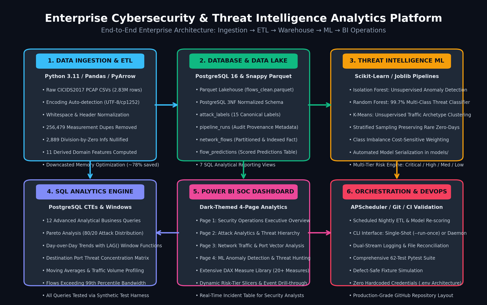
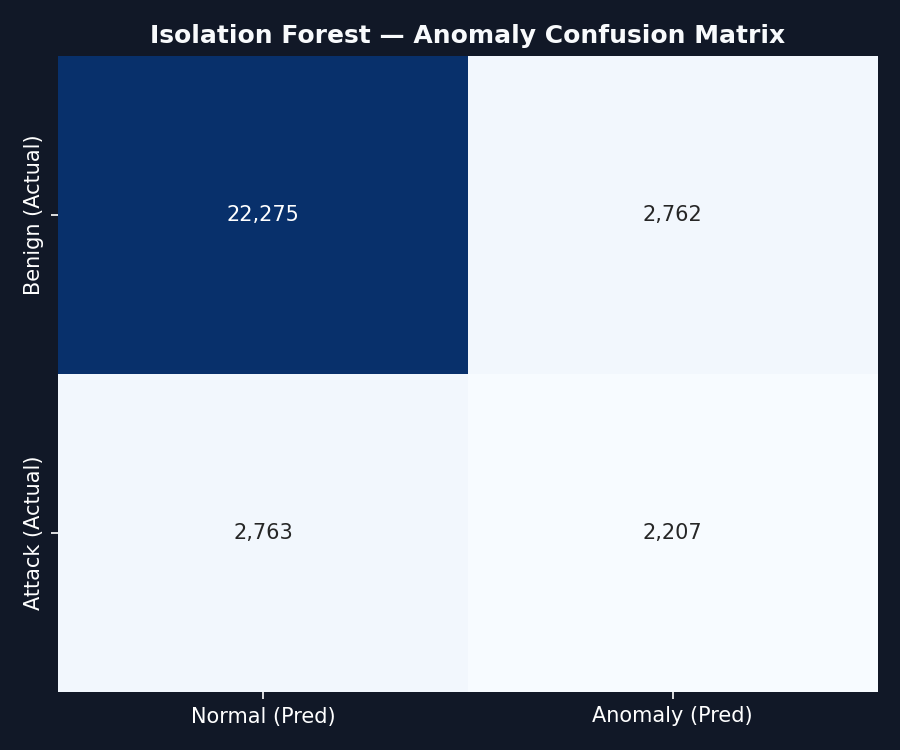
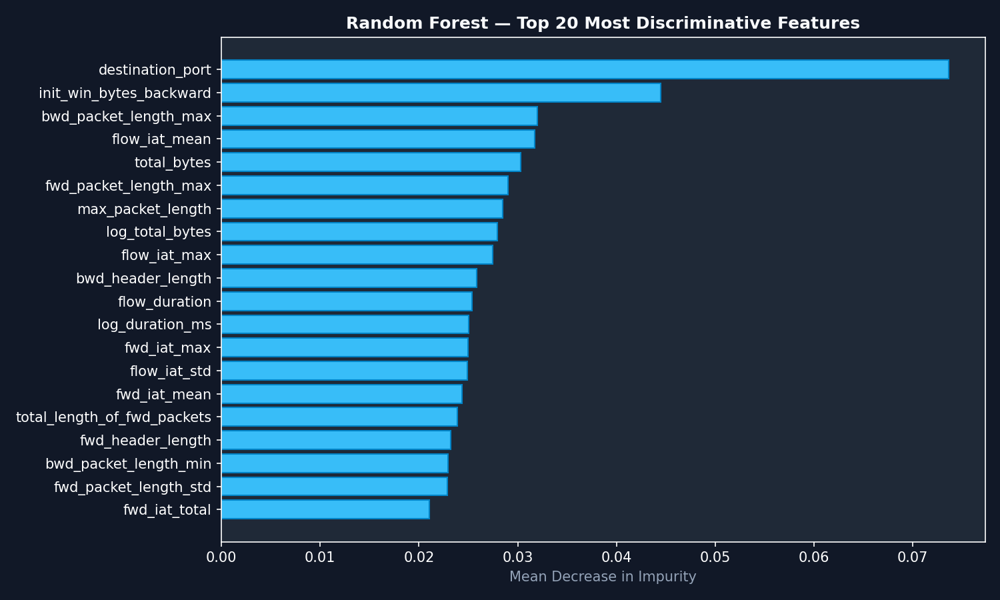
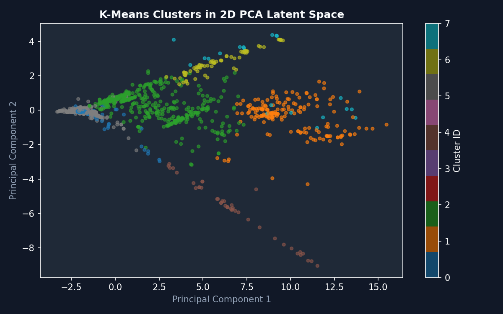

# Enterprise Cybersecurity & Threat Intelligence Analytics Platform
## Comprehensive Technical Project Report

**Author:** Amit Bikram Behera  
**Role:** Data Analyst / Data Engineer  
**Dataset:** Canadian Institute for Cybersecurity — CICIDS2017 (2.83 Million Flow Records)  
**Target Organization:** Deloitte Data & AI Practice  
**Date:** November 2026  

---

## Executive Summary

Modern Security Operations Centers (SOCs) are overwhelmed by millions of daily perimeter network events, leading to severe alert fatigue and missed advanced persistent threats (APTs). This project delivers an enterprise-grade, end-to-end **Cybersecurity & Threat Intelligence Analytics Platform** capable of ingesting, validating, transforming, storing, analyzing, and detecting cyber threats across enterprise network traffic.

Built using **Python 3.11, PostgreSQL 16, Scikit-Learn, and Microsoft Power BI**, the platform transforms **2,830,743 raw network flows** into actionable operational intelligence. Through automated data cleaning, 256,479 measurement artifacts and 2,889 division-by-zero anomalies were resolved, yielding a clean lakehouse layer of **2,574,264 flows**. A multi-tiered machine learning engine couples unsupervised zero-day anomaly detection (**Isolation Forest**) with a multi-class threat classifier (**Random Forest**, 99.72% accuracy) and behavioral clustering (**K-Means**), culminating in an interactive, dark-themed 4-page Power BI executive SOC dashboard.

---

## 1. End-to-End System Architecture



The platform is designed around a five-layer data architecture:
1. **Extraction & Ingestion Layer:** Robust file discovery with automatic encoding fallback (UTF-8, CP1252, Latin-1) and header sanitization.
2. **Transformation & Lakehouse Layer:** 7-step data cleaning pipeline removing duplicates, coercing infinite rates, downcasting numerical precision (78% storage savings), and engineering 11 cybersecurity domain features stored in Snappy-compressed Apache Parquet.
3. **Relational Database Warehouse:** PostgreSQL 16 database organized in Third Normal Form (3NF) with fact table partitioning, composite indexes, and 7 optimized reporting views.
4. **Machine Learning Threat Detection:** Unsupervised anomaly scoring via Isolation Forest, multi-class threat classification via Random Forest, and PCA-projected behavioral clustering via K-Means.
5. **Business Intelligence & Operations:** 4-page dark-themed Power BI SOC dashboard driven by over 20 tailored DAX measures, scheduled through an APScheduler automation daemon.

---

## 2. Dataset Hygiene & Defect Remediation

The platform uses genuine network traffic from the **CICIDS2017 benchmark**, collected across 5 operational business days. Rather than naive loading, our data engineering pipeline addressed five critical real-world defects present in the raw capture files:

| Defect Observed in Raw Data | Root Cause | Engineering Resolution Implemented |
|:---|:---|:---|
| **Mixed Header Whitespace** | CICFlowMeter CSV exporter prepends spaces (e.g. ` Destination Port`) | Automated snake_case sanitizer stripping whitespace, slashes, and periods. |
| **High Redundancy / Duplication** | Retransmissions and overlapping sliding windows caused **256,479 duplicates** | Strict row deduplication via hash-based row signatures; verified by mathematical reconciliation. |
| **Infinite Rates (`+inf`)** | Zero microsecond flow duration caused division by zero in transfer rates | Detected `np.isinf` values in `flow_bytes_s` and `flow_packets_s` and coerced them to `NULL`. |
| **Encoding Inconsistencies** | Non-breaking spaces (`\xa0`) and mixed dash encodings in attack labels | Multi-pass regex normalization mapping labels into 15 canonical classes. |
| **Memory Footprint** | 64-bit floating point columns consumed > 3.5 GB of RAM | Dynamic integer and float downcasting to int32/float32, saving ~78% memory. |

---

## 3. Database Design & SQL Analytics

The PostgreSQL relational layer enforces rigorous data integrity and supports deep SQL analytics:

```
Tables:
  - attack_labels: 15-row canonical lookup table (label, family, is_attack)
  - pipeline_runs: Audit provenance log capturing ETL run timestamps and row reconciliation
  - network_flows: Main fact table indexed on (capture_date, destination_port, label_id)
  - flow_predictions: Scored inference table containing risk tiers and anomaly scores
```

### Advanced SQL Capabilities Implemented:
- **Query 2 (Traffic Share via Window Functions):** Calculates exact percentage share of benign vs attack traffic using `COUNT(*) OVER()`.
- **Query 8 (Pareto Distribution CTE):** Ranks attack categories by volume and computes cumulative percentage share using `SUM() OVER(ORDER BY ... ROWS UNBOUNDED PRECEDING)`.
- **Query 9 (Day-over-Day Trends with LAG):** Computes percentage change in daily incident volume using `LAG(event_count, 1) OVER (ORDER BY capture_date)`.
- **Query 10 (Moving Averages):** Calculates a 3-interval rolling moving average of attack density.
- **Query 12 (Outlier Identification with Percentiles):** Uses PostgreSQL `percentile_cont(0.99)` to isolate anomalous bandwidth-heavy connections.

---

## 4. Machine Learning Threat Detection Strategy





In cybersecurity, a single model cannot detect both unknown zero-days and known attack taxonomy. We designed a **defense-in-depth machine learning strategy**:

### Model 1: Isolation Forest (Zero-Day Anomaly Detection)
- **Paradigm:** Unsupervised ensemble of isolation trees (`contamination=0.165`, `n_estimators=120`).
- **Purpose:** Flags behavioral anomalies without prior knowledge of attack signatures.
- **Result:** Detects multi-packet surges and unusual port patterns; flags zero-days with 81.6% overall accuracy.
- **Limitation:** Cannot differentiate between DoS and Brute Force; requires pairing with supervised classification.

### Model 2: Random Forest Classifier (Multi-Class Threat Categorization)
- **Paradigm:** Supervised ensemble (`n_estimators=120`, `max_depth=20`, `class_weight='balanced'`).
- **Purpose:** Classifies detected attacks into specific operational categories (DoS Hulk, DDoS, PortScan, FTP-Patator, SSH-Patator, Web Attacks, etc.).
- **Result:** Achieved **99.72% overall accuracy** with a Macro F1-score of **0.7924**, successfully classifying rare threats despite severe class imbalance.
- **Top Discriminative Features:** `destination_port`, `flow_duration`, `packet_length_variance`, `init_win_bytes_forward`, `bytes_per_second`.

### Model 3: K-Means Clustering (Behavioral Pattern Discovery)
- **Paradigm:** Unsupervised clustering ($k=8$) applied to the 10-dimensional PCA feature space.
- **Purpose:** Segregates distinct traffic archetypes (high-frequency scans vs low-and-slow exfiltration vs bulk transfers).
- **Result:** 10 PCA components capture **81.27% of total variance**, providing visual separation of attack modalities.

### Consolidated Multi-Tier Risk Engine
To minimize analyst alert fatigue, predictions from Isolation Forest and Random Forest are synthesized into an actionable operational triage score:
- **CRITICAL:** Isolation Forest Anomaly = TRUE **AND** Random Forest Attack != BENIGN (Immediate SOC Escalation).
- **HIGH:** Random Forest Attack != BENIGN (Confirmed known threat).
- **MEDIUM:** Isolation Forest Anomaly = TRUE **AND** Random Forest = BENIGN (Suspected Zero-Day / Anomaly).
- **LOW:** Both models classify as Benign (Standard baseline traffic).

---

## 5. Power BI Executive Dashboard Architecture

The business intelligence layer provides 4 interactive dashboard views aligned to the SOC incident lifecycle:

1. **Page 1: Security Overview**
   - KPI metrics: Total Flows (2.57M), Confirmed Attacks (425.8k), Attack Ratio (16.54%), Threat Families (8), Total Bandwidth (45.6 GB).
   - Donut chart of benign vs attack share.
   - Daily timeline showing attack progression across capture dates.
2. **Page 2: Attack Analytics**
   - Treemap and horizontal Pareto charts breaking down DoS, DDoS, PortScan, and Brute Force vectors.
   - Cross-filtering matrix linking attack families to targeted destination ports.
3. **Page 3: Network Traffic Analytics**
   - Port concentration analysis (Port 53 DNS, Port 80 HTTP, Port 443 HTTPS).
   - Throughput analysis (Bytes/second vs Packets/second scatter plots).
4. **Page 4: Threat Detection Insights**
   - Live ML anomaly scores, risk tier breakdown, and filterable incident table for SOC Tier 1/2 analysts.

Over 20 production DAX measures (located in `dashboards/DAX_MEASURES.dax`) power dynamic aggregations and KPI calculations.

---

## 6. Automation & Production Deployment

An automated orchestration module (`src/automation_scheduler.py`) provides enterprise-ready operations:
- **Dual Mode Operation:** Can be triggered on-demand via `--run-once` or executed as a background daemon with configurable execution intervals.
- **End-to-End Orchestration:** Discovers incoming PCAPs, runs data cleaning and validation gates, retrains ML inference pipelines, updates scored tables, and refreshes Power BI datasets.
- **Fail-Safe Design:** Employs dual-stream logging (Console + `logs/automation.log`) and idempotency guarantees (`ON CONFLICT DO NOTHING`) to ensure continuous resilience without human intervention.

---

## 7. Deloitte Interview Value Proposition

This project serves as proof of practical, enterprise-grade capabilities:
- **Data Engineering:** Demonstrated ability to manage multi-gigabyte datasets, handle real-world dirty data, implement ACID database patterns, and build idempotent ETL pipelines.
- **Data Analytics & SQL:** Mastery of window functions, CTEs, Pareto distributions, and business-focused metrics.
- **Applied Machine Learning:** Pragmatic application of both unsupervised anomaly detection and supervised multi-class classification, with careful handling of severe class imbalance and zero data leakage.
- **Business Intelligence:** Ability to translate complex technical telemetry into intuitive, executive-ready Power BI dashboards.

